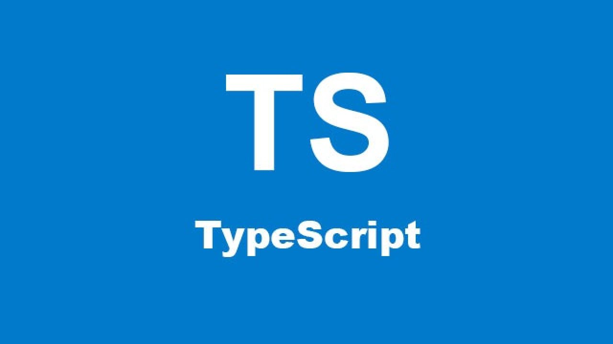
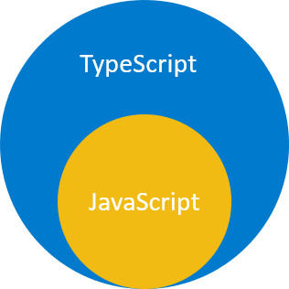
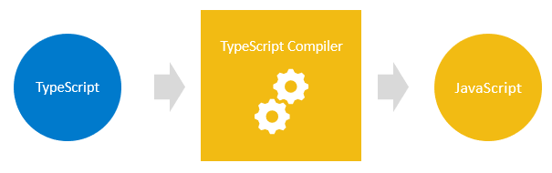

# TypeScript

TypeScript (TS) es un lenguaje de programación libre y de código abierto desarrollado
y mantenido por Microsoft. Es un superconjunto de JavaScript que añade un sistema de
tipos estático y otras herramientas para desarrollar aplicaciones que se ejecutan en
el navegador o en el servidor.

TypeScript parte de la sintaxis de JavaScript y permite añadir tipos de forma gradual.
El compilador analiza el código, muestra los errores que puede detectar y genera
JavaScript que podrá ejecutar el entorno de destino. Los tipos sirven durante el
desarrollo y no aparecen en el JavaScript generado.

## Características de TypeScript

1. TypeScript amplía JavaScript y permite adoptar sus tipos de forma gradual.
2. Los ficheros fuente tienen extensión `.ts` y el compilador puede generar ficheros `.js`.
3. El JavaScript resultante se puede ejecutar en cualquier entorno compatible con la
   versión de ECMAScript elegida como destino.
4. El tipado ayuda a detectar errores antes de ejecutar el programa y mejora las ayudas
   del editor.

## Instalación

Antes de comenzar debemos tener instalada una versión de Node.js compatible, como se
explica en el README principal del workspace.

Esta carpeta declara TypeScript 6.0 como dependencia de desarrollo. Después de descargar
el repositorio entraremos en `00_TypeScript` y ejecutaremos una vez:

    npm install

Después podremos utilizar el compilador local mediante `npx tsc`. De esta forma no
dependemos de una instalación global ni mezclamos versiones entre cursos. El comando
crea la carpeta `node_modules`, que contiene el compilador y no se guarda en Git. Podemos
eliminarla cuando no la necesitemos y reconstruirla ejecutando de nuevo `npm install`.

Podemos comprobar qué versión local estamos usando mediante:

    npx tsc --version

## Contenido de la carpeta

1. `01_TS_HolaMundo`: primer fichero TypeScript y uso de código generado en una página.
2. `02_TS_Tipos`: tipos, variables, arrays, tuplas y uniones.
3. `03_TS_Funciones`: parámetros, valores opcionales y funciones.
4. `04_TS_Clases`: clases, herencia, interfaces y polimorfismo.

## Compilación y ejecución

Para compilar un fichero concreto podemos situarnos en su carpeta y ejecutar, por
ejemplo:

    npx tsc fichero.ts

El ejemplo `01_TS_HolaMundo` modifica el documento HTML, por lo que debemos abrir su
`index.html` en un navegador. Los ejemplos que no utilizan APIs del navegador también
se pueden ejecutar con Node.js:

    node fichero.js

Los ficheros JavaScript generados por el compilador no deberían editarse manualmente.
Si queremos cambiar el código, modificamos el `.ts` y volvemos a compilarlo. En este
material se conservan algunos `.js` generados para poder comparar el código TypeScript
con su resultado JavaScript.

## Sistema de tipos

El sistema de tipos permite definir variables y funciones tipadas sin perder la esencia
de JavaScript. TypeScript comprueba esos tipos durante la compilación; los tipos se
eliminan al generar JavaScript y no realizan validación automática durante la ejecución.

Por ejemplo:

    function sumar(x: number, y: number): number {
      return x + y;
    }

Si intentamos pasar cadenas, TypeScript señalará el error durante la compilación.

## Configuración del compilador

Podemos usar un fichero `tsconfig.json` para definir opciones comunes. El ejemplo
`04_TS_Clases` incluye uno con `target` ES2022 y comprobación estricta de tipos.

Para comprobar ese ejemplo sin generar JavaScript, desde `00_TypeScript` ejecutamos:

    npm run typecheck:clases

Para compilarlo y actualizar su fichero JavaScript:

    npm run build:clases

También podemos entrar en `04_TS_Clases` y utilizar directamente el compilador:

    npx tsc -p .

La opción `-p` indica la carpeta que contiene el `tsconfig.json`. Para observar y
recompilar sus cambios continuamente:

    npx tsc -w -p .

La opción `target` indica la versión de JavaScript que queremos generar. Actualmente no
es necesario limitar todos los ejemplos a ES6; elegiremos un destino moderno compatible
con el entorno donde vayamos a ejecutarlos.

No es necesario cambiar la política general de ejecución de PowerShell. Los scripts de
npm y `npx` permiten ejecutar las herramientas locales manteniendo la configuración de
seguridad del sistema.

## Ventajas principales

1. Detectar incompatibilidades de tipos durante el desarrollo.
2. Mejorar el autocompletado, la navegación y las refactorizaciones del editor.
3. Documentar mediante tipos las entradas y salidas de nuestro código.

## Bibliografía

- [Documentación oficial de TypeScript](https://www.typescriptlang.org/docs/)
- [TSConfig Reference](https://www.typescriptlang.org/tsconfig/)
- [TypeScript Playground](https://www.typescriptlang.org/play)
